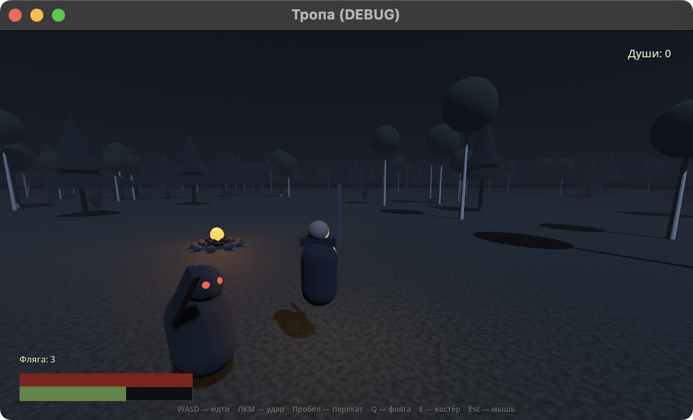

# Тропа

Мрачный соулслайк в русском лесу. Godot 4.7, GDScript, 3D от третьего лица.



## Как запускать

**Способ 1 — из терминала (быстро для тестов):**

```bash
cd ~/Desktop/game
./run.sh            # или: godot --path .
./run.sh model      # витрина модели героя
./run.sh character  # верстак анимаций
```

**Модель героя отдельно.** Кнопка «Модель ГГ» в меню или `./run.sh model`.
Там персонажа можно крутить мышкой, приблизить лицо, посмотреть спину и меч,
включить позы (стойка/шаг/бег/удары/блок) и три варианта света.
Клавиша **F12** — скриншот, **E** — экспорт `models/dhampir.glb` для Blender
или любого просмотрщика glTF. Подробности — `docs/CHARACTER_DHAMPIR.md`.

**Способ 2 — из редактора (удобно править):**

1. Открыть `/Applications/Godot.app`
2. «Import» → выбрать папку `~/Desktop/game` → Import & Edit
3. F5 — запуск, F6 — запустить текущую сцену

**Способ 3 — проверка без окна (ловит ошибки скриптов):**

```bash
godot --headless --path . --quit-after 200
```

Если `godot` не находится в PATH, полный путь:
`/Applications/Godot.app/Contents/MacOS/Godot --path .`

**Телепорт для тестов** — не надо каждый раз идти от костра:

```bash
./run.sh -- --at -30,-46     # поставить игрока у избы
./run.sh -- --at 0,-70       # у края тьмы
```

Выход из игры — Cmd+Q или Esc (освобождает мышь, потом закрыть окно).

## Управление

| Клавиша | Действие |
|---|---|
| WASD | идти |
| Мышь | камера |
| ЛКМ | удар (меч достаётся из-за спины) |
| Tab | захват цели (лок-он), повторно — снять |
| Пробел | перекат, кадр неуязвимости |
| 1–4 | вложить души в ветку (у костра, в меню) |
| F | зажечь/погасить факел |
| Q | фляга лечения |
| E | отдохнуть у костра |
| Esc | освободить мышь |

## Что уже работает

**Мир**
- изба-ориентир на северо-западе: сруб с коллизией, тёплое окно, дым, забор, крыльцо;
- дверь открывается по E, внутри очаг — **второй чекпоинт**: смерть вернёт сюда;
- на столе оберег: забираешь — +25 к здоровью и +1 фляга;
- тропа к избе отмечена берёзами с венками — по ним и держишь путь;
- край карты — стена тьмы: дальше не пройти, за край не выпасть;
- врагов в начале нет: они выходят по одному по мере продвижения по тропе;
- холмистый рельеф: высотная карта 200×200 м, меш и коллизия из одних данных;
- река в вырезанном русле, вода с шейдером течения и френелем;
- 32 000 пучков травы на MultiMesh, качаются в вершинном шейдере;
- 240 деревьев (берёзы и ели), расставлены по высоте и уклону, не лезут в воду;
- туман, луна, приглушённый цвет — депрессивная ночь.

**Бой**
- выносливость: удар и перекат тратят, восстанавливается сама;
- враг с автоматом состояний: замечает → идёт → замахивается → бьёт → стаггер;
- здоровье, урон, HUD.

**Герой — дампир**
- широкополая шляпа с янтарной изнанкой, чёрный плащ с подкладкой, бледное лицо;
- длинные волосы, амулет с синим камнем, пояс с черепом, высокие сапоги;
- меч за спиной: рукоять над правым плечом, на удар вынимается и возвращается;
- факел заменён на пламя в левой ладони: огонь из частиц, живой свет с мерцанием,
  топливо (80 с), заправка у костра;
- модель собрана кодом: 156 мешей, ~49 тыс. треугольников, 27 материалов;
- в игре: 76 fps / 972 draw calls (ночь, 1280×720, M4 Pro);
- готовая модель для просмотра — `models/dhampir.glb`;
- план доведения до идеала — `docs/CHARACTER_UPGRADE_PLAN.md`.

**Петля**
- костёр: лечит, заряжает флягу и факел, возвращает врагов, открывает прокачку;
- души падают с врагов; после смерти остаются на месте гибели и подбираются;
- уровень: четыре ветки — Сила, Выносливость, Чутьё, Ремесло.

**Враги**
- волк: быстрый, короткий замах, бьёт в упор;
- леший: медленный, 240 здоровья, широкий замах на 3 метра;
- кикимора: держит дистанцию, кидает светящийся снаряд и подтягивает к себе;
- послушник в робе: идёт молча, бьёт коротко, ходит по двое;
- плакальщица: висит в воздухе, кричит по площади и отбрасывает.

**Ткань и ветер**
- глобальный ветер с порывами (направление и сила меняются во времени);
- робы врагов колышутся в вершинном шейдере — дешево для десятков моделей;
- плащ героя и волосы качаются от скорости и ветра (процедурный аниматор).

## Структура

```
project.godot            настройки проекта
scenes/main.tscn         корневая сцена
scenes/player.tscn       игрок: коллизия, камера на пружине
scenes/enemy.tscn        враг
scripts/main.gd          сборка мира, костёр, спавн, души
scripts/terrain.gd       высоты, меш рельефа, коллизия, вода
scripts/grass.gd         трава на MultiMesh + шейдер ветра
scripts/dhampir_model.gd   модель ГГ (шляпа, плащ, меч, лицо)
scripts/dhampir_animator.gd стойка, шаг, удары, блок, плащ
scripts/model_viewer.gd    витрина модели
scripts/player.gd        движение, бой, выносливость, факел
scripts/enemy.gd         ИИ врага и телеграфы
scripts/hud.gd           интерфейс
DESIGN.md                дизайн-документ
```

Модели собираются из примитивов и процедурных мешей кодом. Герой — не
заглушка: у него своя сетка головы, ткань плаща, лицо и аниматор. Готовая
модель экспортируется в `models/dhampir.glb`; Blender для правок не нужен.

## Проверка без окна

```bash
godot --headless --path . --quit-after 200
```

Печатает ошибки скриптов и число посаженной травы.

## Git

Репозиторий инициализирован локально. Когда понадобится GitHub:

```bash
gh repo create tropa --private --source=. --push
# или
git remote add origin git@github.com:<user>/tropa.git && git push -u origin main
```

## Дальше по плану

1. Лок-он на врага (Tab) и прокачка душ у костра.
2. Леший и кикимора — другие телеграфы, другой бой.
3. Звук: шаги, ветер, костёр, вой.
4. Нормальные модели (Blender) и анимации.
5. Дождь и лужи, смена суток.
